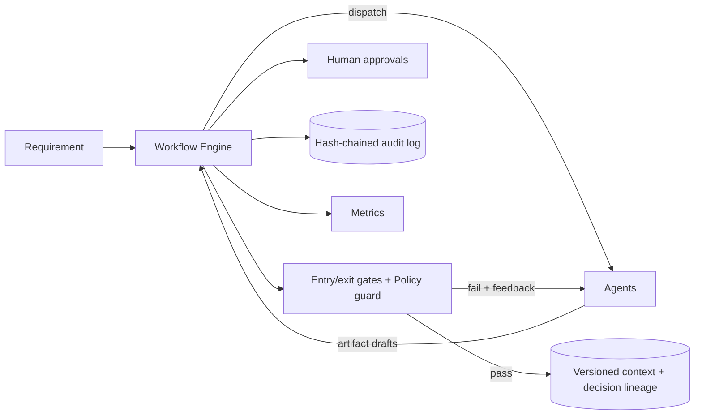

# Architecture

## 1. What it is

A governed workflow engine plus a set of SDLC agents. Agents do the work; the engine owns scheduling, validation, approvals, recovery and evidence.
Principle: **agents execute inside autonomy boundaries; humans own approvals and final quality.**

## 2. Orchestration model (the differentiator)

| Requirement from the brief | Implementation |
|---|---|
| Explicit dependency graph, entry/exit gates | `WorkflowGraph` validates ids, deps, cycles, producer/consumer contracts. `NodeSpec.EntryGates/ExitGates`; engine always checks inputs exist and declared outputs are produced |
| Sequential and parallel paths with synchronization | Any node whose dependencies all succeeded is ready; up to `MaxParallelism` run concurrently; join nodes wait for every dependency (`run-tests` joins implement + author-tests; `release` joins tests, review, docs) |
| Non-linear, stateful execution | Per-node state machine (Pending, Running, AwaitingApproval, Succeeded, Failed, RolledBack, Blocked, Skipped); versioned artifact store |
| Cross-stage context and decision lineage | `WorkflowContext` stores immutable artifact versions with `DerivedFrom` (exact input versions) and a decision log; `TraceLineage` walks it |
| Human approval for high-impact actions | `Impact.High` nodes **must** declare `ApprovalMode` (graph construction fails otherwise). `BeforeExecution` (release) gates the side effect; `BeforeCommit` (design) gates what enters shared state. Approve / Reject / ChangesRequested (rework with feedback) |
| Bounded retries, fallback, rollback, safe-stop | Retries with exponential backoff and failure feedback; fallback agent after exhaustion; `CompensateAsync` rollback in reverse order; `RequestSafeStop` kill-switch; attempt budget; re-plan budget |
| Policy guardrails (security, compliance, change control) | `PolicyGuard` runs on every output of every node (agents cannot opt out): secret scan (Critical), insecure-code patterns (High), required compliance sections in docs (High), undeclared-output rejection (autonomy boundary), approval-required change control. Tooling is least-privilege: `dotnet build/test` only |
| Audit-grade observability | `AuditLog`: every transition, gate result, violation, approval and rollback, hash-chained (tamper-evident) and mirrored to JSONL |
| Reliability metrics | Attempt success rate, retries, rollbacks, re-plans, gate failures, policy violations, approvals, MTTR (first failure to next success per node), end-to-end and per-node latency |
| Dynamic re-planning | Each finished node remembers the input versions it consumed. When any newer version appears (human change, upstream re-run), the node is reset and re-run; downstream nodes re-run only if outputs actually changed (content hash), so there is no needless churn. Bounded by `MaxReplans` |

### Control flow of one node

1. Check inputs exist and entry gates pass (failure is terminal; retrying cannot fix inputs).
2. If `BeforeExecution`, request approval (reject = terminal, action never runs).
3. Loop (bounded): run agent -> reject undeclared/missing outputs -> policy guard -> exit gates -> optional `BeforeCommit` approval -> commit artifacts + decisions.
4. Failure handling: Critical or permanent = stop now; otherwise feed the failure back and retry; then fallback agent; then terminal failure.
5. Terminal failure requests a safe-stop: scheduling halts, in-flight agents are cancelled cooperatively, completed compensable nodes are rolled back, unreached nodes are marked Blocked.

## 3. Agents

Requirements (ambiguity detection -> questions + explicit assumptions), Clarification (human checkpoint), Codebase analysis (keyword hits + type-reference dependents = impact map), Planner (tasks with dependencies and waves), Design (design doc + OpenAPI), Implementation (sandbox only; exact-match patches that abort on drift), Test author, Test runner (real `dotnet test`), Review (static checks), Risk, Test plan, Docs, Release (promotes to a release folder; compensable), Readiness, Summary.

Each agent has two modes. With no LLM configured it replays a deterministic playbook, which makes the demo reproducible and testable. With `ANTHROPIC_API_KEY` set, design, risk and docs are generated by the model and must pass the same gates.

## 4. Scenarios

| Scenario | Input | Shows |
|---|---|---|
| Greenfield | Well-specified requirement (no ambiguity found) | Full pipeline; parallel implement / author-tests / risk; join at run-tests; release approval; final summary |
| Brownfield | "Add optional TTL; expired links return 410 and are not counted" against the existing code | Impact analysis of real files; sandbox copy; 14 exact-match patch operations (abort on drift); existing suite re-run as regression gate plus new expiry tests; extra review checks (expiry before click counting) |
| Ambiguous | "Make it fast and scalable, secure, analytics, etc... expire at some point" | 8 detected ambiguities with assumptions; human clarification in parallel with planning; design only after the join; a late product-owner change mid-run re-plans decompose and design (and anything whose inputs changed) with approvals repeated |

## 5. Key decisions and trade-offs

| Decision | Why | Trade-off |
|---|---|---|
| Engine owns governance, agents are untrusted | Controlled autonomy must not depend on agent good behavior | More engine code; agents are less free |
| Content-hash change detection for re-plan | Avoids cascading re-runs when outputs are identical | Non-deterministic agents (LLMs) can produce differing text and cascade; bounded by `MaxReplans` |
| Retry feeds failure messages back to the agent | Lets a model self-correct (policy, gates, human review) | Deterministic failures (e.g. failing tests) also burn retries; bounded |
| Safe-stop cancels siblings on any terminal failure | Prefer a consistent halt over partial progress | Loses in-flight work of independent branches |
| Compensation is explicit per agent | Honest about what can be undone | Only models local side effects (sandbox, release folder) |
| Sandbox copy, release promotion as a separate approved step | Real repo never mutated by agents | Extra copy step |
| In-memory store behind `ILinkStore` | Keeps the prototype runnable anywhere | Not durable; documented as a limitation |
| 302 redirect | Every click reaches the service so analytics are correct | Slightly more load than 301 |

## 6. Validation and risk control

* Tests: orchestrator behavior (graph validation, parallelism/join, retry, fallback, rollback, critical vs high policy handling, autonomy boundary, approvals, rework, re-plan, re-plan budget, safe-stop, audit tamper detection, lineage) and the service (validation matrix incl. SSRF hosts, idempotency, concurrency, alias rules, collision bounds, API round-trip, rate limit).
* Runtime validation: real `dotnet test` in the sandbox, static review gate, policy guard, readiness gate before release.
* Failure scenarios are executable via `--chaos`.

## 7. Limitations

* Not compiled or run by the author (no SDK available when written); first build may need small fixes.
* Offline agents replay playbooks; they demonstrate orchestration, not model intelligence. LLM mode is implemented but untested.
* Review checks are marker-based heuristics, not SAST/DAST.
* Rollback covers local folders only; no external systems.
* Single process, in-memory state; a production engine would persist run state for crash recovery and resume.
* Approvals are scripted unless `--interactive`.
